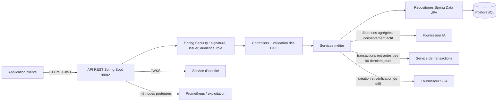

# Financial Coach Service — fonctionnement, travaux réalisés et suite

Ce document explique le fonctionnement du microservice, résume les étapes d’amélioration 1 à 12 et regroupe les points qui restent à traiter. Il complète `README2.md` (état et risques) et `README3.md` (détails et validations de chaque étape).

> **Important :** le dépôt contient un socle fonctionnel et plusieurs protections testées localement, mais il n’est pas encore prêt à être considéré comme un service bancaire de production. Certaines décisions dépendent de fournisseurs, de l’équipe d’identité, de l’exploitation et de la conformité; le code seul ne peut pas les valider.

## 1. Rôle du microservice

`financial-coach-service` est une API REST Java 21 / Spring Boot 3.5. Il fournit des fonctions de coaching et de gestion de coffres d’épargne :

- gérer le profil budgétaire et répartir le revenu entre besoins, envies et épargne;
- analyser des dépenses agrégées avec un fournisseur IA, si le consentement est actif;
- rechercher des versements entrants récurrents via le service de transactions;
- créer et gérer les coffres d’épargne;
- piloter une intention de verrouillage avec une validation SCA avant de créditer le coffre;
- enregistrer le consentement, les événements d’audit, le ledger et les demandes de confidentialité.

Le service ne remplace ni le fournisseur d’identité, ni le service de transactions, ni le fournisseur IA ou SCA. Il authentifie les requêtes à partir des jetons émis par l’identité et appelle ces systèmes lorsqu’une fonctionnalité en a besoin.

Pour l’IA, la configuration actuelle utilise **Groq** avec le modèle `openai/gpt-oss-120b` via une API compatible OpenAI. « Compatible OpenAI » décrit le format de l’API, pas le fournisseur : la clé est `GROQ_API_KEY`. Si par « Grok » tu voulais dire le produit de xAI, c’est un autre fournisseur et il faut utiliser un modèle `grok-*` avec l’URL et la clé xAI.

## 2. Vue d’ensemble de l’architecture

Le code est organisé par responsabilité :

| Répertoire | Responsabilité |
|---|---|
| `controller/` | Routes HTTP; récupère l’identité du JWT, vérifie les entrées et appelle un service. |
| `dto/` | Contrats d’entrée et de sortie, validations des valeurs et limites. |
| `service/` | Règles métier, transactions applicatives et appels aux systèmes externes. |
| `client/` | Client HTTP vers le service de transactions. |
| `sca/` | Contrat SCA, adaptateur HTTP configurable et implémentation désactivée en développement. |
| `model/` | Entités persistées : profil, consentement, recommandation, coffre, intention, ledger et audit. |
| `repository/` | Accès PostgreSQL via Spring Data JPA et requêtes ciblées. |
| `exception/`, `security/` | Conversion cohérente des erreurs métier, HTTP et de sécurité. |
| `config/`, `monitoring/`, `scheduler/` | Vérification de configuration de production, limites HTTP, métriques et purge planifiée. |

## 3. Comment une requête fonctionne

1. **Le client appelle l’API** sous `/api/v1/coach/**`, en joignant un JWT. Les routes métier exigent le rôle `USER`; `/actuator/**` exige `ADMIN`.
2. **Spring Security valide le jeton** : signature à l’aide des clés JWKS, dates, `iss` (issuer) et `aud` (audience). Le claim `role` est converti en autorité Spring. Le claim `sub` est utilisé comme UUID propriétaire des données; un claim `userId` ne peut pas le remplacer.
3. **Le contrôleur valide la requête** avec les DTO et Jakarta Validation. Une limite de taille HTTP de 65 536 octets et des plafonds propres aux opérations évitent les entrées démesurées. Certaines opérations coûteuses sont limitées par utilisateur et par instance.
4. **Le service applique la règle métier**, dans une transaction lorsque nécessaire. Les recherches et modifications de ressources sont limitées à l’utilisateur du `sub`, par exemple `vaultId + userId`, afin de réduire le risque d’accès croisé (IDOR).
5. **Les repositories accèdent à PostgreSQL**. Flyway applique les migrations versionnées au démarrage; Hibernate vérifie ensuite le schéma (`ddl-auto: validate`) sans le modifier automatiquement.
6. **Les appels externes restent séparés** : IA pour les conseils, service de transactions pour les flux entrants et fournisseur SCA pour les défis. Les indisponibilités sont converties en erreurs adaptées ou, pour l’analyse IA, en réponse de repli sans conseil financier validé.
7. **La réponse est renvoyée au client**. Les erreurs utilisent un format `ProblemDetail` avec un code stable et ne révèlent pas les détails internes; les métriques et journaux doivent rester dépourvus de secrets et de données financières inutiles.

## 4. Fonctionnalités et parcours importants

### Profil et allocation budgétaire

`GET/PUT /api/v1/coach/profile` lit ou enregistre le revenu mensuel net et les ratios du propriétaire authentifié. Sans profil existant, la répartition par défaut est 50 % besoins, 30 % envies et 20 % épargne. `POST /api/v1/coach/allocate` calcule les enveloppes à partir des ratios personnalisés ou du profil, arrondit les montants à deux décimales et affecte le reliquat d’arrondi afin que la somme égale exactement le revenu.

### Analyse de dépenses par IA

1. Le client transmet des dépenses agrégées par catégorie à `POST /api/v1/coach/analyze-budget`.
2. Le service vérifie le consentement actif **avant** l’appel externe. Il normalise les catégories, borne les montants et n’envoie pas l’identité, l’adresse IP, le revenu du profil, l’objectif libre ou un historique transactionnel détaillé.
3. Le résultat du modèle est considéré comme non fiable : catégorie/type autorisés, montants et économies sont vérifiés côté serveur; le service limite les conseils à trois, recalcule le total et génère lui-même le texte présenté.
4. Si l’appel échoue ou si la sortie est invalide, le service renvoie un résultat explicitement indisponible, sans économie ni conseil non vérifié.

La configuration par défaut est `AI_BASE_URL=https://api.groq.com/openai`, `AI_MODEL=openai/gpt-oss-120b` et `GROQ_API_KEY`. En local, copier `.env.example` vers `.env` et remplacer la valeur factice de `GROQ_API_KEY` par une clé Groq valide pour effectuer un appel réel. Ne jamais committer cette clé. Les conditions réelles de rétention, d’usage et de localisation des données du fournisseur Groq restent à faire confirmer avant production. Les recommandations validées sont accessibles par la route d’historique, mais leur persistance à la suite d’une nouvelle analyse doit encore être confirmée/complétée.

### Détection d’un salaire récurrent

`GET /api/v1/coach/salary/detect` est limité en débit, puis demande au service de transactions les entrées de fonds des 90 derniers jours. Le code regroupe les crédits significatifs par contrepartie normalisée et cherche des versements espacés de 25 à 35 jours avec une variation maximale de 10 %. Si une récurrence est repérée, il propose une allocation budgétaire; il ne modifie pas automatiquement le profil.

### Coffres et confirmation SCA

Les routes `/api/v1/coach/vaults` permettent de créer, lister, renommer et supprimer un coffre vide. Une suppression avec solde positif est refusée.

Pour créditer un coffre, le parcours est en deux temps :

1. `POST /vaults/{vaultId}/lock-intent` vérifie la propriété du coffre et le plafond, enregistre une intention `PENDING` de cinq minutes, puis demande un défi au fournisseur SCA.
2. `POST /vaults/{vaultId}/lock-confirm` exige le code SCA et l’en-tête `Idempotency-Key`. Le service vérifie le même utilisateur, coffre, intention et montant; un défi expiré, réutilisé ou ayant dépassé cinq échecs est refusé.
3. Après validation positive seulement, le coffre est crédité et le ledger ainsi que l’audit sont écrits dans la transaction PostgreSQL.

Le code est conçu pour fermer le parcours si aucun fournisseur SCA n’est configuré. L’intégration réelle et l’approbation du fournisseur sont toutefois encore nécessaires avant toute opération réelle.

### Confidentialité, migrations et exploitation

- `GET/PUT /api/v1/coach/me/consent` consulte ou modifie le consentement IA.
- `GET /api/v1/coach/me/export` exporte les données gérées par ce microservice.
- `DELETE /api/v1/coach/me/data` supprime les données effaçables et pseudonymise certaines traces conservées. La demande est bloquée si un coffre a un solde positif; le service externe d’identité, le fournisseur IA et le fournisseur SCA ne sont pas effacés par cet endpoint.
- Flyway contient les migrations `V1` à `V7`. Elles créent les tables, les coffres/ledger/intentions, le consentement et les recommandations, puis renforcent le SCA, l’intégrité du ledger et l’anonymisation.
- La purge quotidienne supprime les recommandations arrivées à `expires_at`. Les durées de conservation des journaux, du ledger et des autres données conservées ne sont pas encore décidées juridiquement.

## 5. Routes principales

Toutes les routes de ce tableau nécessitent un JWT avec rôle `USER`.

| Méthode | Route | Fonction |
|---|---|---|
| `GET`, `PUT` | `/api/v1/coach/profile` | Lire ou mettre à jour le profil budgétaire. |
| `POST` | `/api/v1/coach/allocate` | Calculer une allocation. |
| `POST` | `/api/v1/coach/analyze-budget` | Produire des conseils vérifiés à partir de dépenses agrégées. |
| `GET` | `/api/v1/coach/recommendations` | Lire l’historique paginé des recommandations. |
| `GET` | `/api/v1/coach/salary/detect` | Analyser les crédits récents via le service de transactions. |
| `POST`, `GET` | `/api/v1/coach/vaults` | Créer et lister les coffres. |
| `PATCH`, `DELETE` | `/api/v1/coach/vaults/{vaultId}` | Renommer ou supprimer un coffre autorisé. |
| `POST` | `/api/v1/coach/vaults/{vaultId}/lock-intent` | Créer l’intention et demander le défi SCA. |
| `POST` | `/api/v1/coach/vaults/{vaultId}/lock-confirm` | Confirmer avec SCA et `Idempotency-Key`. |
| `GET`, `PUT` | `/api/v1/coach/me/consent` | Lire ou modifier le consentement IA. |
| `GET` | `/api/v1/coach/me/export` | Exporter les données du microservice. |
| `DELETE` | `/api/v1/coach/me/data` | Demander l’effacement pris en charge. |
| `GET` | `/actuator/health`, `/actuator/prometheus` | Santé et métriques; rôle `ADMIN` requis. |

Les chemins d’Actuator sont protégés même si `health`, `info` et `prometheus` sont configurés comme exposables par Spring Actuator.

## 6. Étapes déjà traitées

Les étapes correspondent à `README3.md`. « Implémentée » ne signifie pas toujours « validée en production ».

| Étape | Ce qui a été fait | Pourquoi | État actuel |
|---|---|---|---|
| **1. Protéger Actuator** | Tous les chemins `/actuator/**` exigent `ADMIN`; tests d’accès anonyme, `USER` et `ADMIN`. | Éviter qu’un utilisateur ou un visiteur obtienne des métriques ou des informations opérationnelles. | Tests ciblés réussis; la suite complète a été validée ultérieurement selon l’étape 11 de `README3.md`. La vérification continue en CI GitHub reste à confirmer. |
| **2. Valider les JWT** | Validation de signature JWKS, `iss`, `aud` et dates; claims de rôle convertis en autorités; issuer et audience obligatoires. | N’accepter que les jetons destinés à cette API et émis par l’identité de confiance. | Implémentée et tests ciblés réussis; valeurs réelles, rotation JWKS et contrat d’identité à confirmer. |
| **3. Isoler les utilisateurs** | `sub` UUID comme propriétaire; accès aux ressources et recherches filtrés par utilisateur; tests avec identités différentes et claim `userId` contradictoire. | Empêcher les accès/modifications entre comptes (IDOR / contrôle d’accès brisé). | Code et tests unitaires présents; stabilité/formats réels de `sub` et tests d’intégration PostgreSQL d’accès croisé à confirmer. |
| **4. Séparer local et production** | Profil `prod` sans secrets par défaut; validateur refuse placeholders, DB locale et URLs non HTTPS; Compose de production et modèle `.env.example`. | Éviter les démarrages en production avec des secrets ou services de développement. | Validations applicatives faites; vérifier le Compose dans un environnement Docker et injecter les valeurs via un gestionnaire de secrets. |
| **5. Borner entrées et usages** | Contraintes sur montants, ratios, texte, pagination et taille HTTP; limiteur IA et salaire par utilisateur/instance. | Réduire les erreurs métier, abus, appels coûteux et épuisement de ressources. | Tests ciblés réussis; le quota doit devenir partagé si plusieurs instances sont déployées. |
| **6. Consentement et minimisation IA** | Refus sans consentement actif; prompt limité aux catégories normalisées et montants agrégés. | Donner à l’utilisateur un contrôle explicite et réduire l’exposition de données financières. | Code et tests présents; conditions contractuelles, rétention et région du fournisseur à confirmer. |
| **7. Vérifier les sorties IA** | Validation stricte catégories/types/montants, trois conseils maximum, textes reconstruits côté serveur, total recalculé et fallback neutre. | Ne pas traiter une sortie probabiliste comme une vérité ni afficher des montants inventés. | Implémentée et tests ciblés réussis. |
| **8. Adapter le SCA** | Interface de fournisseur, adaptateur HTTP, contexte du défi lié à utilisateur/intention/coffre/montant, expiration cinq minutes, cinq tentatives et échec fermé. | Exiger une vraie validation d’opération et réduire le risque de rejeu/bruteforce. | Adaptateur en place; choix, approbation et tests avec le fournisseur réel toujours nécessaires. |
| **9. Ledger et idempotence** | Verrou consultatif PostgreSQL par clé, rejeu exact contrôlé, conflit `409` si clé détournée, contraintes de cohérence et test de confirmations concurrentes. | Éviter les doubles crédits, y compris lors de requêtes simultanées ou de reprises réseau. | Migrations et test de concurrence PostgreSQL validés localement. |
| **10. Confidentialité et rétention** | Export élargi; effacement transactionnel, blocage avec solde positif, anonymisation des traces conservées, purge quotidienne des recommandations expirées. | Permettre l’accès et l’effacement tout en préservant les liens comptables nécessaires. | Implémentation et tests PostgreSQL présents; durées et fondements de conservation à faire approuver juridiquement. |
| **11. Erreurs, métriques et alertes** | `ProblemDetail`, erreurs 4xx/5xx cohérentes, journaux assainis, métriques bornées et règles Prometheus initiales. | Faciliter le diagnostic sans exposer de secrets ni de données personnelles. | Code fait; branchement Prometheus/Alertmanager, routage d’astreinte et seuils à configurer en exploitation. |
| **12. Contrôles de livraison** | GitHub Actions de tests/build, PostgreSQL de service, Dependency-Check, Trivy, SBOM CycloneDX et Dependabot. | Détecter régressions et vulnérabilités avant intégration et rendre les composants inventoriables. | Configuration présente localement; exécution GitHub et protection de branche à vérifier après publication. |

## 7. Ce qu’il reste à mettre en œuvre ou à valider

Les prochains travaux doivent rester séparés, un point à la fois, comme demandé dans `README3.md`.

### Priorité 1 — terminer les validations bloquant une intégration réelle

1. **Fournisseur SCA réel** : choisir et faire approuver un fournisseur, confirmer son contrat HTTP, le mode de délivrance et l’usage unique des défis, configurer `SCA_PROVIDER_BASE_URL`/`SCA_PROVIDER_API_TOKEN` via le gestionnaire de secrets, puis tester le parcours de bout en bout avec refus, expiration, panne et confirmation réussie.
2. **Contrat du service d’identité** : confirmer que `sub` est un UUID stable, récupérer les vraies valeurs `JWKS_URI`, `JWT_ISSUER`, `JWT_AUDIENCE` et `role`, valider la rotation des clés et exécuter des tests d’intégration PostgreSQL prouvant qu’un utilisateur A ne peut accéder aux ressources de B.
3. **Fournisseur IA et conformité** : la configuration utilise Groq avec `openai/gpt-oss-120b`; obtenir la validation des régions de traitement, de la rétention, de l’usage des données et des clauses contractuelles; injecter la vraie `GROQ_API_KEY` hors du dépôt. Le consentement ne remplace pas l’approbation juridique ou contractuelle. Si le besoin était xAI Grok plutôt que Groq, confirmer ce choix avant de changer de fournisseur/modèle.
4. **Règles de rétention et effacement** : faire approuver par conformité/DPO et juridique les délais, bases de conservation, exceptions ledger/audit et conditions de suppression chez les fournisseurs. Implémenter les durées approuvées, plutôt que d’en inventer dans le code.
5. **Service de transactions** : fournir `SERVICES_TRANSACTION_SERVICE_BASE_URL`, confirmer le format de réponse et l’autorisation interservice (le client transmet actuellement le JWT reçu), puis tester timeout, panne, erreur d’authentification et données invalides.

### Priorité 2 — compléter le comportement et la preuve par les tests

6. **Historique des recommandations** : persister les recommandations IA valides dans `BudgetRecommendation`, selon la politique de rétention approuvée; décider si les résultats de repli sont historisés et tester l’isolation par utilisateur. La route d’historique existe, mais elle ne garantit pas à elle seule que les analyses récentes y sont enregistrées.
7. **Vérifier l’état complet des tests** : lancer la suite Maven dans l’environnement CI doté de son PostgreSQL de service, corriger les échecs réellement reproductibles, et ajouter/maintenir des tests de bout en bout pour les opérations autorisées, refusées, les dépendances indisponibles, les migrations et les courses concurrentes.
8. **Débit multi-instance** : remplacer le limiteur en mémoire par une passerelle ou un stockage distribué avant le déploiement horizontal; les compteurs actuels ne coordonnent pas plusieurs réplicas.
9. **Résilience des fournisseurs** : mesurer latence/erreurs et vérifier timeouts, politiques de reprise et circuit breaker pour IA, SCA et service de transactions; une reprise ne doit jamais dupliquer une opération financière.

### Priorité 3 — exploitation et livraison

10. **Publier et valider la CI GitHub** : pousser le workflow, exécuter la CI, régler les échecs éventuels et ajouter `Verify, scan, and build` aux contrôles obligatoires de la branche `main`. Ajouter `NVD_API_KEY` comme secret GitHub recommandé pour Dependency-Check. Confirmer l’existence et le contenu des artefacts SBOM et rapports.
11. **Déployer le monitoring** : configurer Prometheus pour lire `/actuator/prometheus` avec l’accès `ADMIN`, importer `monitoring/prometheus-alerts.yml`, raccorder Alertmanager et le canal d’astreinte, puis ajuster les seuils aux données d’exploitation.
12. **Durcir l’environnement réel** : stocker les secrets dans le gestionnaire de secrets de la plateforme, imposer TLS en entrée et entre services selon l’architecture, protéger PostgreSQL et ses sauvegardes, vérifier les règles réseau et effectuer un déploiement Compose/platforme avec les vraies configurations.
13. **Revue de sécurité avant production** : réaliser une revue de menace et des tests de sécurité/pénétration autorisés, traiter les constats et documenter les procédures d’incident et de mise à jour des dépendances/images.

## 8. Ordre conseillé pour la suite

1. Publier le workflow et vérifier son premier résultat GitHub; activer ensuite la protection de branche.
2. Confirmer les contrats d’identité, de transactions et les choix du fournisseur SCA, sans mettre de secrets dans Git.
3. Faire approuver les règles de confidentialité/rétention et les conditions du fournisseur IA.
4. Implémenter les éléments métier restant (dont la persistance des recommandations) et leurs tests, une tâche indépendante à la fois.
5. Brancher le monitoring et préparer l’environnement de déploiement sécurisé.
6. Refaire une validation complète et une revue de sécurité avant toute mise en production.

## 9. Références dans le dépôt

- `README2.md` : état initial, périmètre OWASP et risques.
- `README3.md` : détails techniques, validations et statut des étapes 1 à 12.
- `src/main/java/com/neobank/coachservice/` : implémentation Java.
- `src/main/resources/db/migration/` : migrations PostgreSQL Flyway `V1` à `V7`.
- `Dockerfile`, `docker-compose.yml`, `docker-compose.prod.yml` : construction et exécution des conteneurs.
- `.github/workflows/ci-security.yml`, `.github/dependabot.yml` : automatisation de livraison et mises à jour.
- `monitoring/prometheus-alerts.yml` : règles d’alerte initiales.
